<div align="center">

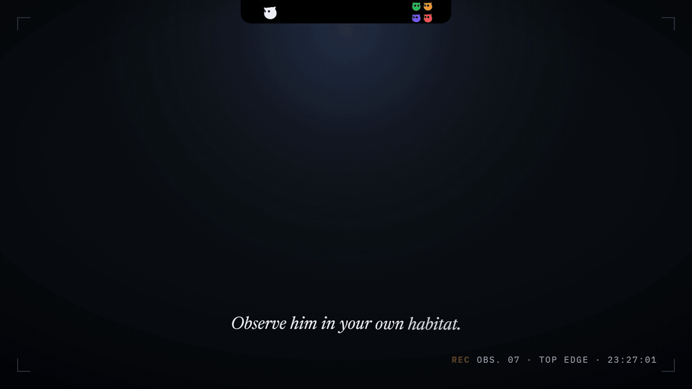

<h3>A little owl who lives at the top of your Windows screen.</h3>

He keeps watch over your coding agents, keeps your day, and notices the little things.

<br>

<a href="https://github.com/DeimosS0/puhu/releases/latest">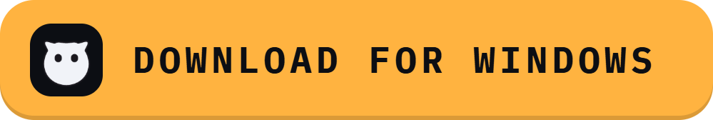</a>

<sub>Free · open source · Windows 10 and 11 · an early release, in active development</sub>

</div>

<br>

## Field notes

Puhu is a small black island at the top-centre of the screen, with an owl in it.
Rest the pointer on it and he peeks out; click and the island opens. Everything
he does happens up there, without a window to switch to.

<table>
<tr>
<td width="50%" valign="top">
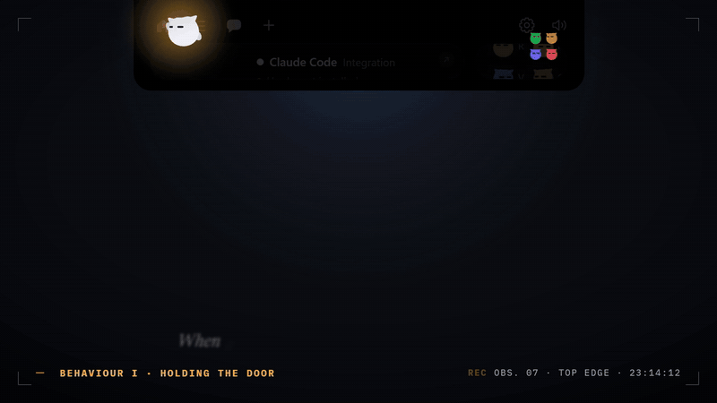
<p><sub><b>BEHAVIOUR I</b></sub><br><b>He holds the door.</b> A Claude Code permission request opens the island with <b>Deny / Allow</b>; a question shows its options; a finished session shows what it did, with a live diff of every file it edited. Nothing goes through without your click.</p>
</td>
<td width="50%" valign="top">
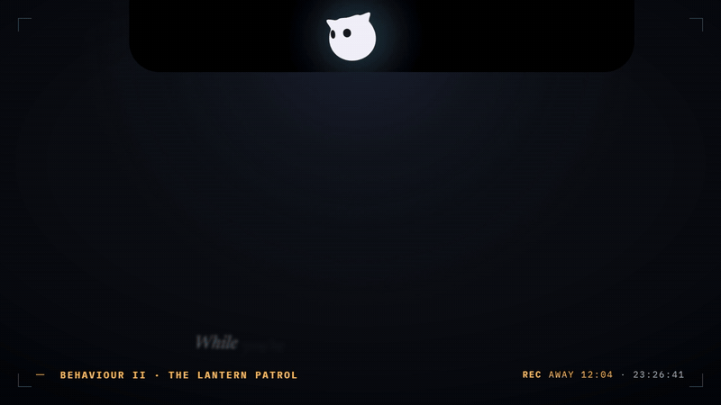
<p><sub><b>BEHAVIOUR II</b></sub><br><b>He walks a lantern patrol.</b> Away from the computer while an agent works, Puhu walks up and down the closed island with a lantern. When you are back he is startled, the lantern flashes, and he tells you what finished meanwhile.</p>
</td>
</tr>
</table>

### Behaviour III · Reflexes

<table>
<tr>
<td width="50%" valign="top">
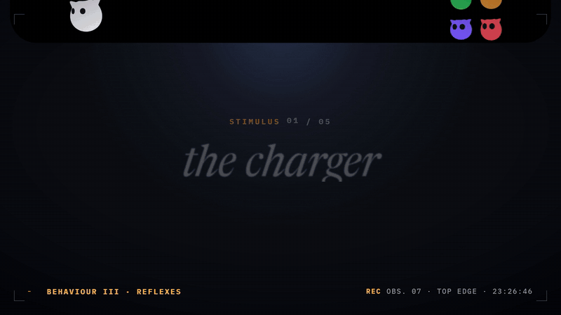
<p><b>The charger</b> → takes a sip from a battery-shaped juice box.</p>
</td>
<td width="50%" valign="top">
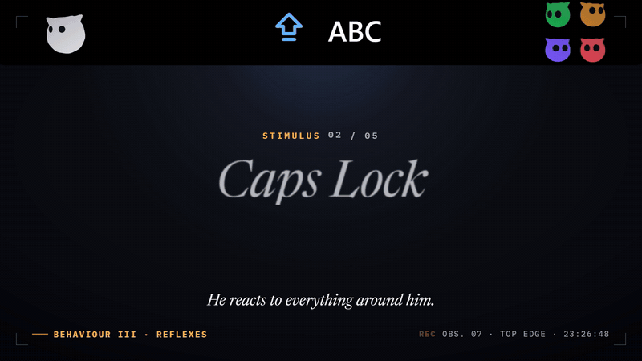
<p><b>Caps Lock</b>, again and again → objects, loudly.</p>
</td>
</tr>
<tr>
<td width="50%" valign="top">
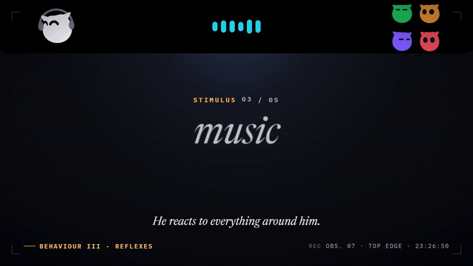
<p><b>Music</b> → dances to the beat, with rhythm bars that follow the song.</p>
</td>
<td width="50%" valign="top">
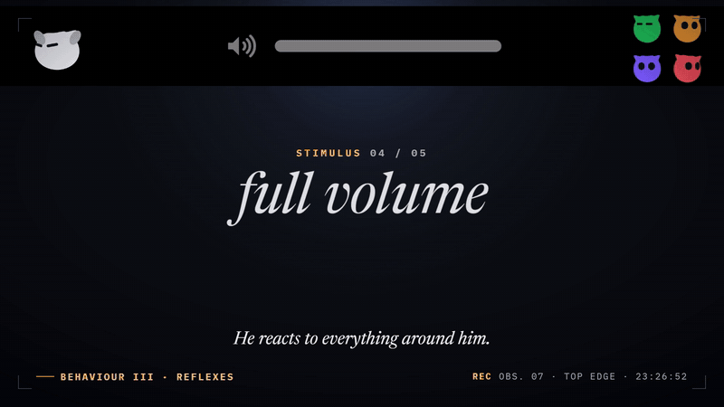
<p><b>Full volume</b> → covers his ears.</p>
</td>
</tr>
<tr>
<td width="50%" valign="top">
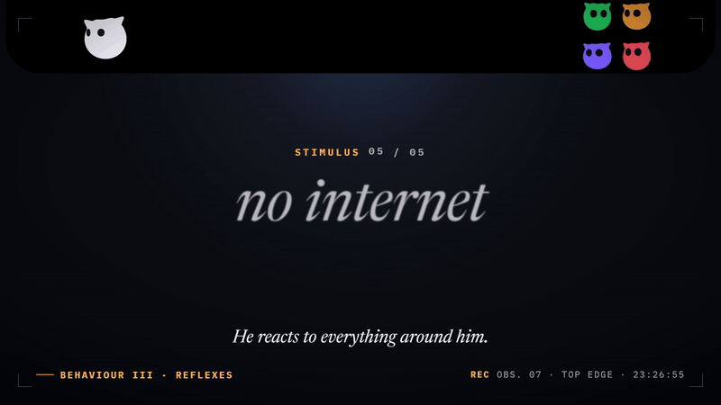
<p><b>No internet</b> → puts up an antenna. When a camera comes on he smooths his feathers; with headphones on, he puts a pair on too.</p>
</td>
<td width="50%" valign="top">
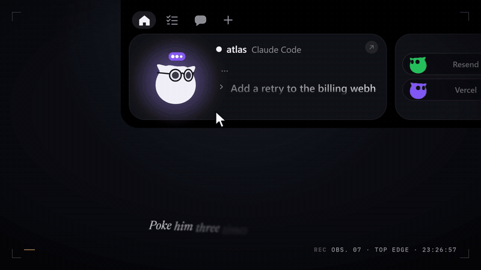
<p><sub><b>BEHAVIOUR IV</b></sub><br><b>Defensive display.</b> Click him and he gets annoyed; three times and he is dizzy. Researchers advise against it.</p>
</td>
</tr>
</table>

### Behaviour V · Keeping the day

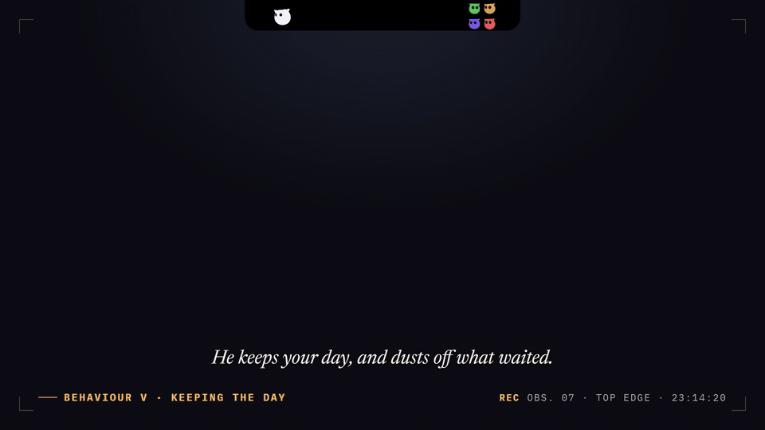

Write what there is to do, in the island (<kbd>Ctrl</kbd> + <kbd>Alt</kbd> + <kbd>B</kbd>) or in Puhu's
window: "tomorrow 14:00 dentist", "friday report". It lands on its day and time; what is
not done comes along to the next day, gathering dust until Puhu blows it off. A written
line flies into the list as a slip of paper, a thing done flies to Puhu as a paper plane.
Once a day, the first time you sit down, a short peek says what there is to do; in the
evening he says how the day went. Puhu's window shows the week.

## More of him

**Focus with Puhu.** A Pomodoro timer with points, levels and titles; a daily goal
he tries on with you; a streak kept by shields when you miss a day; three quests
and an egg every day; feathers to spend; a weekly race against your own recent
weeks, in leagues; badges. Hold Puhu for his card. It can be switched off in
Settings, and the rules are in [docs/gamification.md](docs/gamification.md).

**Puhu's Nest.** A page of its own in Puhu's window: a tree that grows with your
rounds and follows the seasons, your numbers and leagues, a calendar of your days,
the feather shop (a shield, new colours for Puhu) and every badge. The secret ones
stay hidden until found.

**Your other agents.** Codex, Copilot CLI, Gemini CLI, Cursor, OpenCode and a few more
get their own pills ([Supported agents](#supported-agents)). The island's header can show
your Claude and Codex plan limits.

**The rest of the island.** What is playing (Spotify or any app in the Windows media
controls); your services as coloured pills (Stripe, GitHub, Vercel, n8n, Notion, Resend,
Cal.com and others, each with your own key); a chat with Claude or another provider,
and a file dropped on the island goes to it; a weekly recap of your coding sessions.

**Puhu himself.** Rest the pointer on him for hearts. Right-click for his wardrobe
(his colours). Drag him out of the island and he lives on your desktop until you drop
him back. Some of the small things you do earn a secret badge; which ones is for you
to find.

## Install

Download `Puhu-Windows-…-setup.exe` from the
**[latest release](https://github.com/DeimosS0/puhu/releases/latest)**. It installs for
you alone, no administrator needed. The installer isn't code-signed yet, so Windows
SmartScreen warns the first time: **More info → Run anyway**. Puhu asks once whether he
may look for new versions; after that a new version is one click in the island, and he
installs only one he has signed.

## Privacy

- No telemetry. Network requests only go to the services you set up yourself.
- Keys and tokens live in Windows Credential Manager, never in a file.
- Your focus history is a log on this computer (`%APPDATA%\Puhu\progress.log`),
  signed so an edit is noticed. Nothing about it leaves the machine.
- Puhu never approves a permission, sends a message or an email without your click.

## Claude Code

Open **Settings → Agents → Claude Code → Install hooks…**. You see the exact diff
of what will change in `%USERPROFILE%\.claude\settings.json` and the path of the
dated backup, and nothing is written until you click. Your own hooks are never
touched, and uninstalling removes only Puhu's entries.

The relay is a tiny executable, `puhu-hook.exe`, copied to
`%LOCALAPPDATA%\Puhu\bin\` at launch. It gives Puhu 300 ms to answer and exits
cleanly if the app is closed, slow or crashed: **a Claude Code session is never
blocked or slowed down by Puhu.** If nobody answers a permission request, Claude
Code asks in the terminal as usual.

## Supported agents

Every agent is installed from **Settings → Agents** the same way: the diff, the
backup, nothing written until you click.

| Agent | Installs | Permissions |
|---|---|---|
| Claude Code | `.claude\settings.json` | Allow / Deny and questions in the island |
| Codex | `.codex\hooks.json` — then trust the hooks once with `/hooks` in Codex | Allow / Deny in the island |
| GitHub Copilot CLI | `.copilot\hooks\puhu.json` | Allow / Deny in the island |
| Muse Code | `.config\muse\settings.json` | Allow / Deny in the island |
| Gemini CLI | `.gemini\settings.json` | asked in Gemini CLI |
| Antigravity | `.gemini\config\hooks.json` (a `puhu` hook group) | asked in Antigravity |
| Cursor Agent | `.cursor\hooks.json` | asked in Cursor |
| Claude Desktop | nothing: its Claude Code sessions are tagged by the relay | asked in the Claude app |
| OpenCode | plugin `.config\opencode\plugins\puhu.js` | asked in OpenCode |
| Amp | plugin `.config\amp\plugins\puhu.ts` | asked in Amp |
| Hermes Agent | plugin `.hermes\plugins\puhu\` — then `hermes plugins enable puhu` once | asked in Hermes |
| Any other | run `puhu-hook --agent <name> [<Event>]` from your tool's hooks | asked in the tool |

The relay never lets anything through on its own: with no click it gives no
decision, and the agent asks in its own terminal exactly as it would without Puhu.

## Build it yourself

You need [Rust](https://rustup.rs) (1.90 or newer), [Node 20+](https://nodejs.org)
and the **MSVC build tools** (Visual Studio Build Tools, "Desktop development with
C++"). WebView2 ships with Windows 10/11.

```powershell
npm install
npm run tauri dev                          # live-reloading development build
npm run tauri build -- --bundles nsis      # the installer, in target/release/bundle/nsis/
npm test                                   # the front end's tests
cargo test -p puhu --lib                   # the Rust side's tests
```

Puhu's icon and sounds are made in code: `npm run icons` regenerates
`src-tauri/icons` from `scripts/gen-icons.mjs`, and `scripts/make-sounds.py`
writes the WAVs in `sounds/`. The log is `%LOCALAPPDATA%\Puhu\puhu.log`; it stays
on your machine.

<details>
<summary>Where things are</summary>

```
src/              the island, Puhu's window and the settings (TypeScript, no framework)
  puhu/           Puhu himself, drawn in Canvas 2D, and the launch greeting
  island/         the island's state machine, hooks, focus play, surprises
  views/          every view of the island
  hub/            Puhu's window: the Nest, the week, the settings pages (Flow and mail, set aside)
  nest/           the tree
  core/           state, the bridge to Rust, Pomodoro, progress, quests, badges, shop
  i18n/           strings.json, every string in the 14 languages
src-tauri/        the Rust side: windows, the hook pipe, providers, pollers, the progress log
hook/             puhu-hook.exe, the agents' relay
docs/             gamification.md (how focus play works), game-mode.md
scripts/          icons, sounds, release signing; readme-media.mjs builds the README's `media` branch
```

</details>

## Languages

English, 简体中文, हिन्दी, Español, العربية, Français, বাংলা, Português (Brasil),
Русский, Bahasa Indonesia, Deutsch, Türkçe, 한국어 and 日本語. Every string is in
`src/i18n/strings.json`, keyed by its English text; `npm test` fails when one is
missing in a language.

## License

The code is under the [Apache License 2.0](LICENSE); keep [NOTICE](NOTICE) with it.
Puhu's name, character, icon and sounds are not part of it: see [ASSETS.md](ASSETS.md).
The pictures on this page are Puhu's own, recorded from the app itself.

<br>

<p align="center"><sub><i>The study is ongoing.</i></sub></p>
